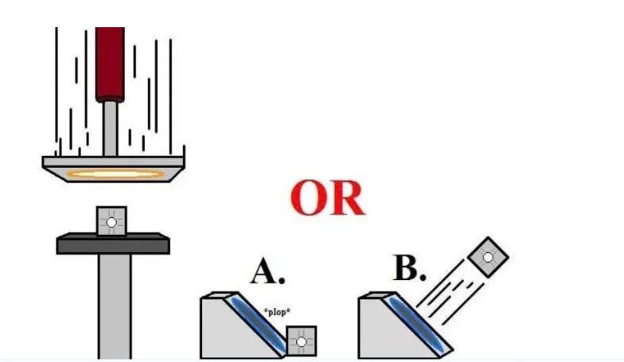
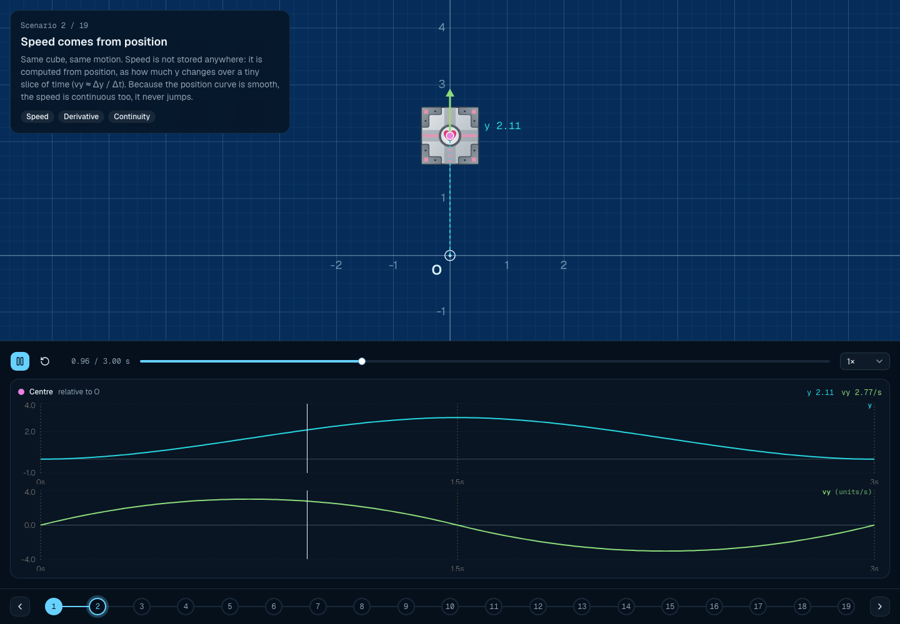
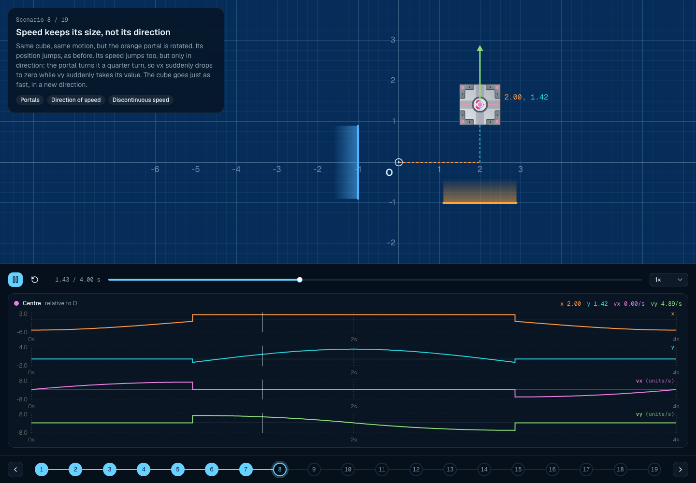
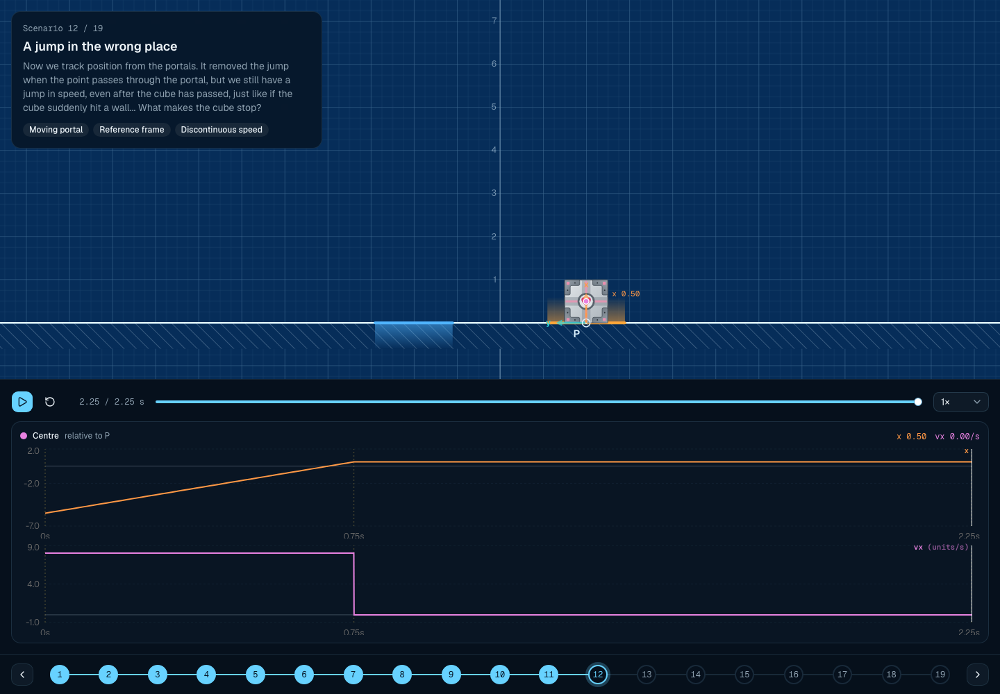
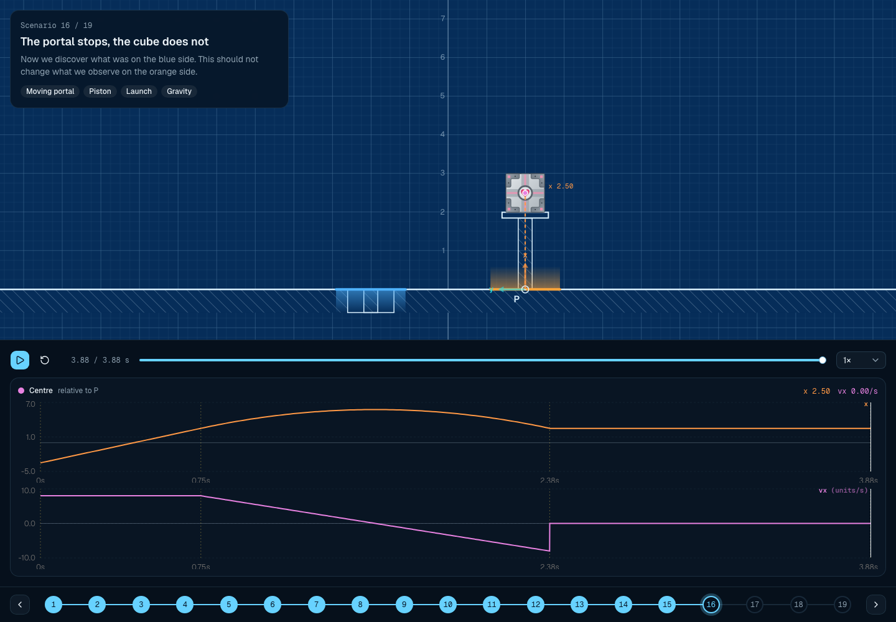
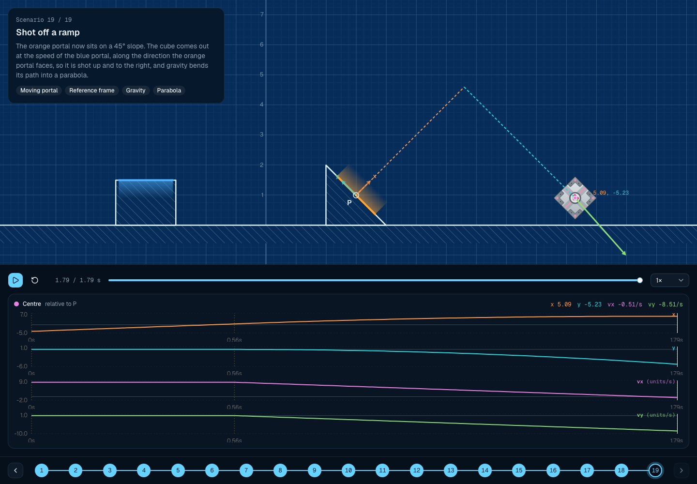

# The Portal Paradox

**Try it live: [portalphysics.xyz](https://portalphysics.xyz)**



A blue portal, mounted on a fast-moving piston, comes down over a cube sitting still on a platform. The matching orange portal is fixed on a slope. When the cube comes out of the orange portal, does it:

- **A.** simply plop out and fall at the foot of the slope, since the cube itself was never moving, or
- **B.** get launched out, since from the orange side the cube comes out as fast as the blue portal went down?

Both answers have strong arguments, and the internet has been arguing about it for years.

## The approach

Rather than arguing, this project tries to find the answer with physics, using **simulations of increasing complexity**. Each scenario adds a single new idea to the one before it, and plots the cube's position and speed over time, so you can see exactly where things are continuous, where they jump, and why.

The rule that drives everything: **speed only changes when something acts on the cube**. Gravity changes it gradually, an impact changes it abruptly. A jump in speed with no cause is a sign that something is wrong with the model.

The scenarios build up in steps.

### 1. Basics (scenarios 1 to 3)

Position over time, speed as the rate of change of position, and how gravity and impacts change speed.



### 2. Fixed portals (scenarios 4 to 10)

Portals can make the position jump, and rotated portals can turn the direction of speed. By measuring the cube from the portals instead of from a fixed point, both jumps disappear: going through a portal is just moving on.



### 3. A moving portal (scenarios 11 to 13)

The blue portal comes down over a still cube. If the cube stops when it comes out, its speed jumps for no reason, as if it hit an invisible wall. If it keeps the portal's speed, the only remaining jump is the impact with the floor, which has a cause.



### 4. The piston argument (scenarios 14 to 18)

A piston launching a cube is compared with the same piston being swallowed by the portal. Shrinking the piston down to nothing gives the same result: it was never about the piston.



### 5. The original setup (scenario 19)

The orange portal is on a 45° slope, and the cube is shot up and to the right along a parabola.



## Running it

```bash
pnpm install
pnpm dev
```

Then open [http://localhost:3000](http://localhost:3000) and step through the scenarios.

Scenarios live in [`src/scenarios/`](src/scenarios), listed in order in [`src/scenarios/index.ts`](src/scenarios/index.ts).
